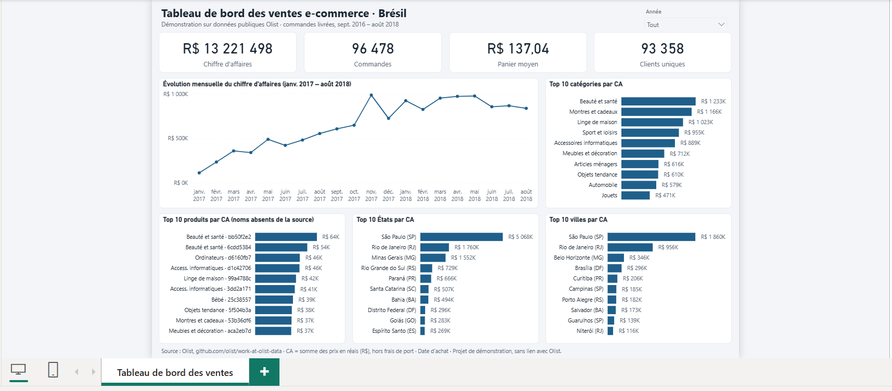

# Tableau de bord des ventes e-commerce · Démonstration Power BI

Projet de portfolio sur des données publiques. Ce n'est pas une mission pour un client, et il n'a aucun lien avec Olist.

## Objectif

Lire en moins de 30 secondes le chiffre d'affaires, les commandes, le panier moyen, la tendance mensuelle, et les meilleurs produits, catégories, villes et États.

## Résultats principaux

- Chiffre d'affaires : R$ 13 221 498, hors frais de port
- Commandes livrées : 96 478 · panier moyen : R$ 137,04 · clients uniques : 93 358
- De janvier à août : CA multiplié par 2,4 entre 2017 et 2018
- Pic mensuel : novembre 2017, R$ 987 765, dont R$ 149 917 sur la seule journée du 24
- São Paulo, Rio de Janeiro et Minas Gerais : 63,4 % du CA

## Méthode

- Modèle en étoile : `Fait_Ventes`, `Dim_Date`, `Dim_Produit`, `Dim_Client`
- Fait au grain d'un article commandé
- CA = somme de `price`, hors `freight_value`
- Commandes `delivered` uniquement, datées à l'achat
- Clients comptés avec `customer_unique_id`
- Villes toujours affichées avec leur État

Détails, mesures DAX et chiffres de contrôle : [docs/guide_technique.md](docs/guide_technique.md).

## Ouvrir le projet

Ouvrir `Olist_Ventes.pbix` dans une version récente de Power BI Desktop.

Pour régénérer les CSV : `python scripts/preparer_donnees.py <csv_bruts> donnees`.

## Limites

Données de 2016 à 2018, décrites par Olist comme un échantillon. Elles ne montrent ni les coûts, ni la marge, ni les retours. Les noms de produits sont absents et les montants sont en réais.

## Source et licence

- Source : [olist/work-at-olist-data](https://github.com/olist/work-at-olist-data), © 2019 @olist, licence MIT (texte dans `donnees/LICENCE_SOURCE_OLIST_MIT.txt`)
- Page du jeu de données : [Brazilian E-Commerce Public Dataset by Olist](https://www.kaggle.com/datasets/olistbr/brazilian-ecommerce)
- Modifications : filtrage des commandes livrées, jointures, traduction des catégories en français, libellés de produits et de villes, table de dates

Olist est un nom appartenant à son propriétaire et n'est cité ici que comme source des données.
